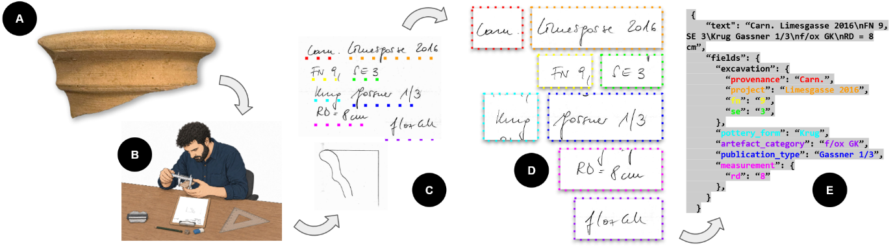

# 🏺CENTURIA
A benchmark for handwritten text recognition and structured field extraction from archaeological pottery records.

This repository contains the evaluation pipeline for the CENTURIA dataset. The dataset and fine-tuned checkpoints for transcribing and extracting structured metadata from the Carnuntum pottery archive are hosted on Zenodo.
It is part of the [LEGION project](https://legion-hsa-2-0.github.io/).

The preprint is available on [arxiv](https://doi.org/10.48550/arXiv.2608.30616).

## 📄 Abstract


<p align="center">
  <em>
    <b>From analogue archaeological documentation to structured metadata.</b>
    <b>A:</b> Excavated sherd,
    <b>B:</b> Manual documentation by a specialist,
    <b>C:</b> Scanned handwritten record (retro-digitized),
    <b>D:</b> Automatically transcribed fields (HTR),
    <b>E:</b> Structured machine-readable metadata (KIE)
  </em>
</p>

Pottery is a primary source for reconstructing the chronological and economic dimensions of past societies. 
Archaeologists often document ceramic finds through technical drawings and handwritten metadata. 
This metadata is critical for dating, provenance attribution, and cross-site comparison, but remains inaccessible to computational analysis, requiring manual transcription of every record. 
We investigate whether state-of-the-art document analysis models can address this task, and introduce CENTURIA, a dataset of 507 pottery records from the Roman site of Carnuntum, providing transcriptions, bounding boxes, and structured field-level labels across seven metadata categories. 
Benchmarking five OCR models reveals a substantial domain gap: zero-shot transcription error reaches 15-32% SpACER-M, far exceeding rates on printed archival documents, with domain-specific fields recovered in fewer than 3% of cases. 
LoRA fine-tuning on just 57 samples, reflecting a realistic archival annotation budget, closes this gap, reducing transcription error to below 1.5%  and recovering overall field-level accuracy above 87%. 
Our results show that a small expert-validated fine-tuning set suffices to convert handwritten pottery documentation into structured, searchable metadata ready for archaeological databases. 

## 📂 Dataset
CENTURIA contains 507 scanned pottery records (57 train/450 test), each annotated with a full transcription, bounding boxes, position of the technical drawing, and structured metadata fields. 
Transcriptions and field values are in German and follow the original notation on the records.

The dataset is available on [Zenodo](https://zenodo.org/records/24140993). A description of the annotation format is provided in the Zenodo record.

After downloading, place the images and annotations in `data/CENTURIA_DATASET/`:
```
data/
└── CENTURIA_DATASET/
    ├── images/
    └── annotations.json
```

## 🤖 Models and checkpoints
| Model | #Parameters | Baseline Checkpoint | Our Fine-tuned Checkpoint
|-------|-------------|---------------------|----------------------|
| TrOCR | 558M | [microsoft/trocr-large-handwritten](https://huggingface.co/microsoft/trocr-large-handwritten) | - |
| Florence2 | 770M | [florence-community/Florence-2-large](https://huggingface.co/florence-community/Florence-2-large) | - |
| olmOCR | 7B | [allenai/olmOCR-7B-0225-preview](https://huggingface.co/allenai/olmOCR-7B-0225-preview) | - |
| olmOCR2 | 7B | [allenai/olmOCR-2-7B-1025](https://huggingface.co/allenai/olmOCR-2-7B-1025) | link |
| LightOnOCR | 1B | [lightonai/LightOnOCR-2-1B](https://huggingface.co/lightonai/LightOnOCR-2-1B) | link |

Models without a fine-tuned checkpoint are evaluated zero-shot. Fine-tuning uses LoRA (57 samples, 2 epochs).
## 🎛️ Domain adaptation
None of the models has seen archaeological terminology during pre-training, which limits zero-shot transcription quality. Three strategies are compared:
- **Zero-shot instruction prompting:** It replaces the generic transcription instruction with a domain prompt listing site abbreviations, vessel forms, ware types, measurement conventions and known publication references. No labelled data is required.
- **Few-shot prompting:** It adds annotated image-transcription pairs (1, 5 and 8 examples) to the input, demonstrating the expected output format without updating weights.
- **LoRA fine-tuning:** It adapts the model weights on the 57-sample training split via low-rank decomposition applied to all linear projection layers. This dominates both prompting strategies, reducing the transcription error below 1.5%.
  
## 📊 Evaluation metrics
**Transcription:**
- **SpACER (micro):** [Spatially Aware Character Error Rate](https://github.com/JonnoB/SpACER) compares predicted and ground truth characters within each bounding box, matched by overlap. Used for models that output box coordinates.
- **SpACER (macro):** The same quantity with character counts but across the whole page instead of per box. Therefore, it also applies to models that return text without coordinates.
- **BoW-F1:** It checks how many words of the ground truth appear in the prediction, regardless of where on the page they occur.

**Field-level transcription:**
- **EMR:** Exact Match Rate checks whether a field value appears exactly as written in the transcription. One wrong character counts as a miss.
- **ANLS:** Average Normalised Levenshtein Similarity measures how close the transcribed value is to the ground truth. Nearly correct readings still receive partial credit, while readings differing by more than half their characters score zero (tau=0.5).

**Field extraction:**
- **Field Accuracy:** It compares the extracted values against the ground truth after normalising case, spacing and delimiters. Reported per field and overall.

## 🚀 Getting started

**1. Clone the repository and install dependencies**

Tested with Python 3.11, CUDA 12.6 and NVIDIA RTX 3090 GPUs (24 GB).
```bash
git clone https://github.com/gissuvalentina/CENTURIA.git
cd CENTURIA
pip install -r requirements.txt
pip install flash-attn==2.8.3 --no-build-isolation   # needed for olmOCR and olmOCR2
```

**2. Download the dataset**

Download the dataset from [Zenodo](https://zenodo.org/records/24140993) and place it in `data/CENTURIA_DATASET/`.

**3. Fine-tune a model (optional)**

Fine-tune a model with LoRA on the 57-sample training split:
```bash
python main.py finetune lightonocr --epochs 2
```
The merged checkpoint is saved to `checkpoints/lightonocr__lora__ep2__n57/`. Alternatively, use our fine-tuned checkpoints.

**4. Transcribe**

Zero-shot, with the domain prompt, with few-shot examples, or with a fine-tuned checkpoint:
```bash
python main.py transcribe lightonocr
python main.py transcribe lightonocr --prompt data/prompts/ocr_prompt.txt
python main.py transcribe lightonocr --fewshot data/fewshot/examples_5.json
python main.py transcribe lightonocr --finetuned checkpoints/lightonocr__lora__ep2__n57
```
Available models: `trocr`, `florence2`, `olmocr`, `olmocr2`, `lightonocr`. Prompts and few-shot examples are supported by olmOCR2 and LightOnOCR. Results are written to `results/transcriptions/`.

**5. Extract fields**

Extract field values from a transcription with REGEX or an LLM (Qwen3-8B, needs a GPU):
```bash
python main.py extract regex results/transcriptions/lightonocr.json
python main.py extract llm results/transcriptions/lightonocr.json
python main.py extract regex ground_truth    # upper bound: fields from the ground-truth text
```
Results are written to `results/fields/`.

**6. Evaluate**

Compare a transcription or field file with the ground truth:
```bash
python main.py evaluate results/transcriptions/lightonocr.json
python main.py evaluate results/fields/lightonocr__regex.json
```
Reports are written to `results/reports/`.

## 📝 Citation
If you find our work useful, we'd appreciate it if you cite us:

```bibtex
@misc{naghavi2026centuria,
      title={{OCR}-Based Field Extraction for Archaeological Pottery Metadata: The {CENTURIA} Dataset}, 
      author={Gissu Valentina Naghavi and Dominik Hagmann and Martin Kampel and Irene Ballester},
      year={2026},
      eprint={2608.30616},
      archivePrefix={arXiv},
      primaryClass={cs.CV},
      url={https://arxiv.org/abs/2608.30616}
}
```

## 🙏 Acknowledgements
This work was carried out within the project LEGION (machine **LE**arnin**G**-enabled **I**dentification of archaeological **O**bjects in the middle da**N**ube river basin). 
The project is funded by the Austrian Academy of Sciences (OeAW) through the Heritage Science Austria 2.0 program (grant number: Heritage_2024-12_LEGION).

## ⚖️ License
This project is licensed under the CC-BY 4.0 License.
